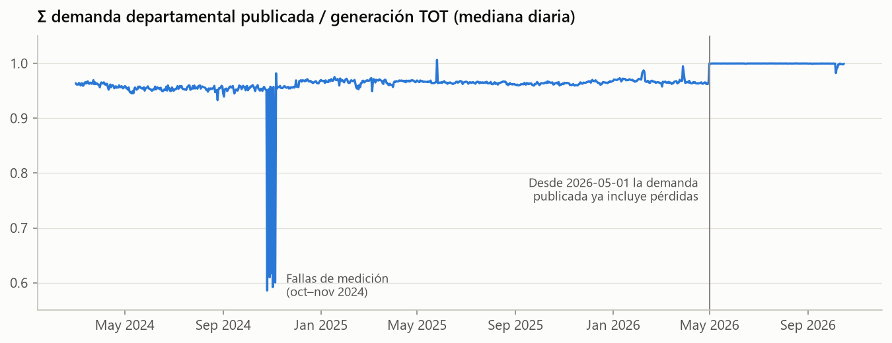
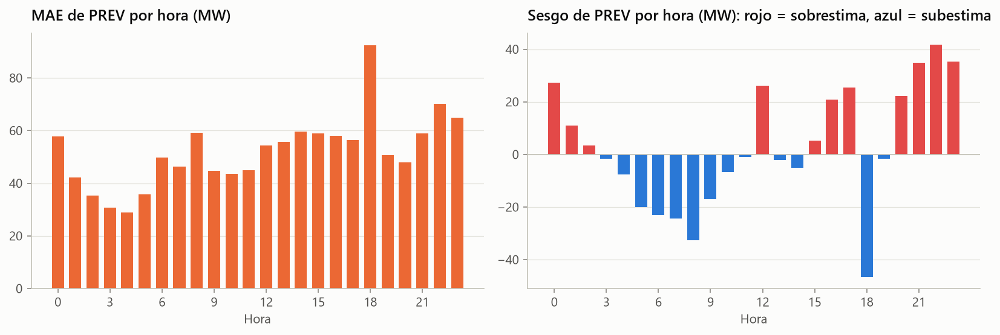
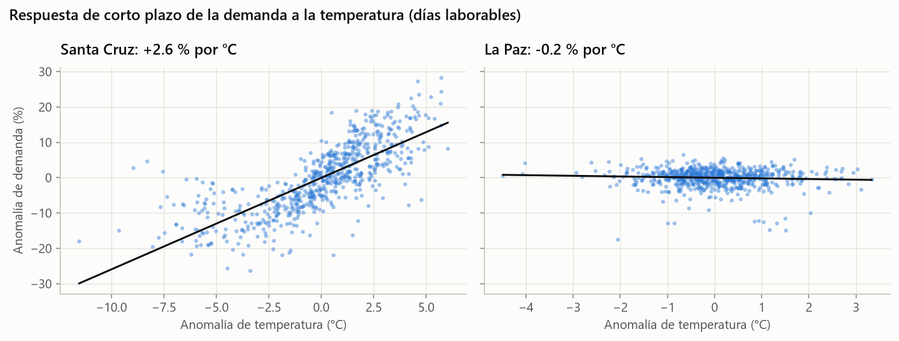
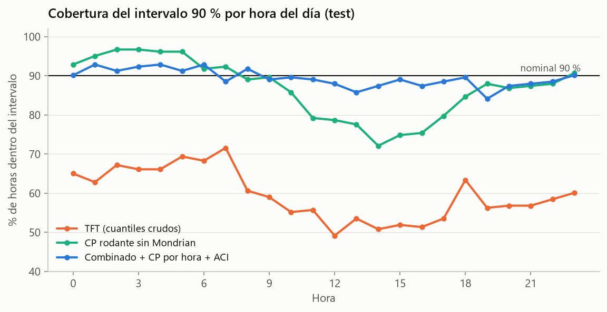
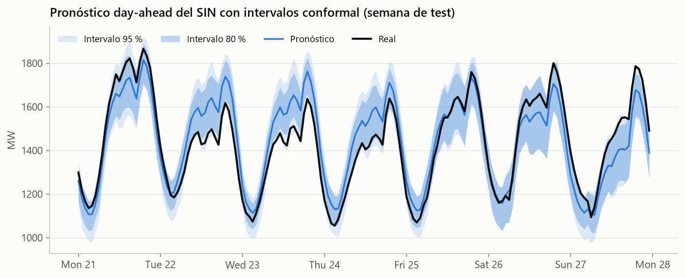

# Forecasting probabilístico de la demanda eléctrica de Bolivia ⚡🇧🇴

Pronóstico **day-ahead** (24 h) de la demanda horaria del **Sistema Interconectado Nacional (SIN)** y de sus 8 departamentos, con **intervalos de predicción con garantía estadística** (Conformal Prediction). Se usan **datos reales** del operador de la red boliviana.

> 🚧 Proyecto en construcción. El plan completo está en [`docs/plan-forecasting.md`](docs/plan-forecasting.md).

## El problema

El CNDC (Comité Nacional de Despacho de Carga) programa cada día cuánta generación térmica, hidroeléctrica y de reserva se despacha para el día siguiente. Un pronóstico puntual sin medida de incertidumbre obliga a elegir entre dos males: **sobredimensionar la reserva** (más gas quemado y más costo) o **arriesgar déficit**. Este proyecto entrega cuantiles calibrados que buscan superar al pronóstico oficial del CNDC (`PREV`).

## Datos

| Fuente | Qué | Resolución | Desde |
|---|---|---|---|
| [API pública del CNDC](https://www.cndc.bo/wp-json/cndc/v1) `rt/demanda` | Demanda (MW) por departamento | 15 min | 2024-03-01 |
| [API pública del CNDC](https://www.cndc.bo/wp-json/cndc/v1) `rt/generacion` | Generación por tecnología + pronóstico oficial `PREV` | 15 min | 2024-03-01 |
| [Open-Meteo Previous Runs](https://open-meteo.com/en/docs/previous-runs-api) | Clima de las 8 capitales: observado y **pronosticado 48 h antes** (sin leakage) | 1 h | 2024-03-01 |
| [`holidays`](https://pypi.org/project/holidays/) | Feriados nacionales y departamentales de Bolivia | día | — |

## Hallazgos del EDA

Detalle completo en [`notebooks/01_eda.ipynb`](notebooks/01_eda.ipynb).

**1. Los datos crudos tienen trampas.** La demanda departamental cambió de definición el 2026-05-01 (empezó a incluir pérdidas: +4 % artificial) y tiene fallas de medición en oct–nov 2024. Se concilia contra la generación total, que es una medición independiente.



**2. El benchmark es exigente.** El pronóstico oficial del CNDC tiene un MAPE de 3.9 % (MAE 52 MW), contra 6.7 % del naive semanal. Su error se concentra en la rampa de las 18 h, donde el intervalo del 90 % llega a 317 MW, frente a 116 MW de madrugada. Por eso hacen falta **intervalos condicionales por hora**.



**3. El oriente manda.** Santa Cruz (40 % del SIN) sube +2.6 % por cada °C y Beni +5.8 %/°C. El altiplano no responde a la temperatura.



## Resultados del backtest

Pronóstico del día D con datos hasta D−2 23:00 (la misma anticipación que el predespacho del CNDC). Son 183 días de test (2026-04-17 → 2026-10-16), evaluados con ventana móvil diaria.

| Modelo | MAE (MW) | MAPE | Cobertura 80/90/95 % | CRPS |
|---|---|---|---|---|
| **Combinado (Ensamble + PREV corregido) + conformal** | **38.3** | **2.86 %** | **79 / 89 / 94** | **14.9** |
| Ensamble LightGBM + TFT + conformal | 44.0 | 3.29 % | 79 / 89 / 95 | 17.4 |
| TFT (cuantiles crudos, sin calibrar) | 47.3 | 3.54 % | 49 / 60 / 68 ⚠️ | 23.6 |
| Pronóstico oficial CNDC (`PREV`) | 54.8 | 4.09 % | — | — |
| Naive semanal | 83.2 | 6.12 % | — | — |

- **−30 % de error frente al pronóstico oficial**, con intervalos cuya cobertura coincide con la nominal **en cada hora del día** (conformal por hora + ACI).
- **Hallazgo:** el error del CNDC es en gran parte un sesgo sistemático por hora. Corregirlo con su propia historia reciente baja su MAE un 22 %.
- Los miembros del ensamble se eligieron con el periodo de calibración, sin mirar el test.
- Detalle y ablaciones en [`docs/plan-forecasting.md`](docs/plan-forecasting.md).





## Cómo reproducir

```bash
uv sync --all-groups          # entorno completo (Python 3.13)
uv run poe data               # descarga incremental → data/processed/*.parquet
uv run poe backtest           # backtest de todos los modelos → artifacts/ + reports/
uv run poe reporte            # tabla de métricas a partir de artifacts/
uv run poe intervalos         # intervalos conformal + figuras
uv run poe test               # tests
uv run poe lint               # ruff
```

Salidas de `poe data` (formato largo de Nixtla `unique_id, ds, y`, con `ds` = inicio de la hora local de Bolivia):

- `demanda_horaria.parquet`: 8 departamentos + `SIN` (MW). `y` está conciliado con la generación total (Σ deptos = `TOT`), `y_medido` es el valor publicado por el CNDC e `imputado` marca las horas reparadas.
- `generacion_horaria.parquet`: `TOT`, `TERMO`, `HIDRO`, `SOLAR`, `EOL`, `BAGAZO`, `RENO`, `PREV` (MW).
- `clima_horario.parquet`: clima por departamento; las columnas `*_d2` son el pronóstico hecho 48 h antes de cada hora (el único libre de leakage con el corte en D−2).
- `calidad.json`: faltantes, imputación y chequeos de coherencia.

### Redes neuronales en Kaggle (GPU gratis)

NHITS y TFT son lentos en CPU. `kaggle/` arma un dataset privado (código + datos) y un kernel con GPU T4:

```bash
uv run poe kaggle-preparar --usuario <usuario> --modelos nhits tft
cd kaggle/_build/dataset && kaggle datasets create -p .   # o `datasets version -p . -m "..."`
cd ../kernel && kaggle kernels push -p .
kaggle kernels output <usuario>/forecast-energia-backtest -p kaggle/_build/salida
# copiar salida/artifacts/backtest/SIN/{nhits,tft}.parquet a artifacts/backtest/SIN/ y correr `poe reporte`
```

En Windows conviene exportar `PYTHONIOENCODING=utf-8` antes de usar el CLI de Kaggle, y ejecutarlo desde dentro de la carpeta (`-p .`).

## Estructura

```
src/forecast_energia/
  config.py            rutas, endpoints, departamentos
  data/cndc.py         cliente API CNDC con caché mensual
  data/weather.py      cliente Open-Meteo
  data/calendar.py     feriados y calendario
  data/processing.py   limpieza, interpolación de huecos cortos, agregación horaria
  data/build.py        pipeline de datos (CLI)
  data/io.py           lectura de datasets procesados
  analysis.py          análisis exploratorio reutilizable
  evaluation.py        protocolo de backtest, métricas y Diebold-Mariano
  features.py          exógenas futuras (calendario + clima pronosticado 48 h antes)
  models/              naive, MSTL, LightGBM, NHITS/TFT, ensamble, combinación con PREV
  conformal.py         split conformal, CQR y ACI (Mondrian por hora)
  pipelines/backtest.py backtest + reporte (CLI)
  pipelines/intervalos.py intervalos conformal + comparación + figuras (CLI)
  viz.py               estilo de gráficos (paleta validada para daltonismo)
notebooks/01_eda.ipynb único notebook: EDA
kaggle/                ejecución de las redes neuronales en Kaggle con GPU
artifacts/backtest/    pronósticos del backtest (insumo de conformal y de la demo)
reports/figures/       figuras del README
tests/                 pytest (con respuestas reales de la API como fixtures)
docs/                  plan del proyecto
```
