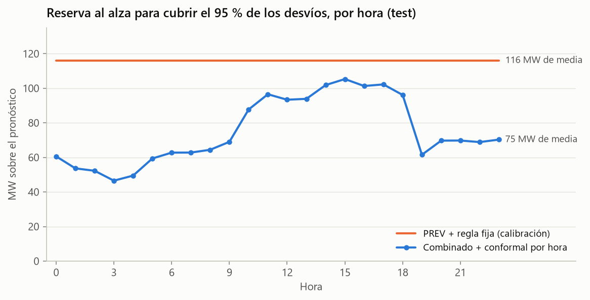
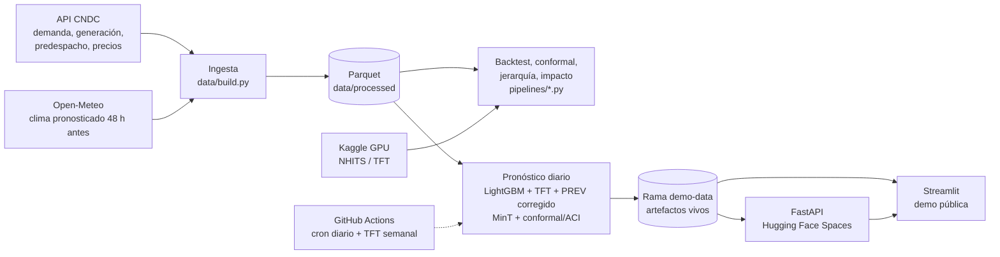
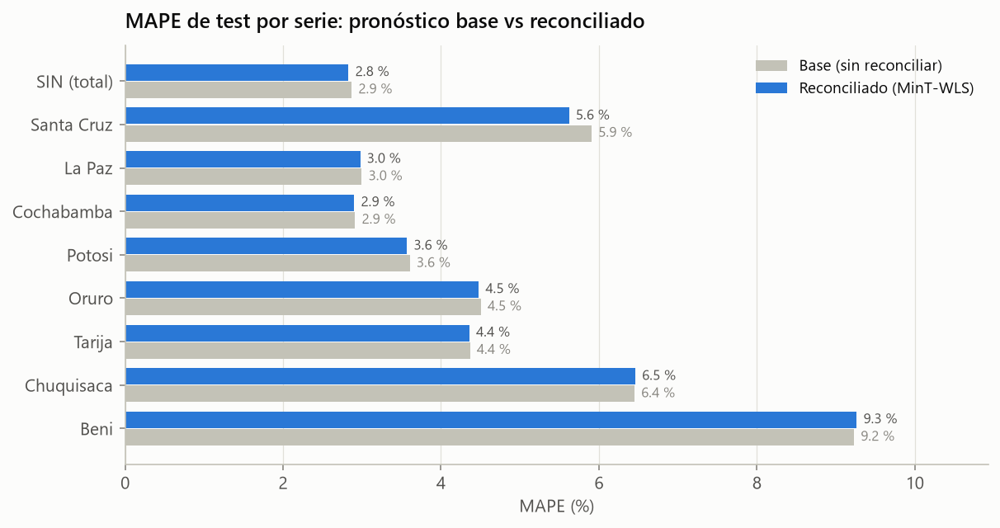

# Forecasting probabilístico de la demanda eléctrica de Bolivia ⚡🇧🇴

Pronóstico **day-ahead** (24 h) de la demanda horaria del **Sistema Interconectado Nacional (SIN)** y de sus 8 departamentos, con **intervalos de predicción con garantía estadística** (Conformal Prediction). Se usan **datos reales** del operador de la red boliviana.

> 🚧 Proyecto en construcción: falta publicar la demo (Fase 8) y la documentación final (Fase 9).

## El problema

El CNDC (Comité Nacional de Despacho de Carga) programa cada día cuánta generación térmica, hidroeléctrica y de reserva se despacha para el día siguiente. Un pronóstico puntual sin medida de incertidumbre obliga a elegir entre dos males: **sobredimensionar la reserva** (más gas quemado y más costo) o **arriesgar déficit**. Este proyecto entrega cuantiles calibrados que buscan superar al pronóstico oficial del CNDC (`PREV`).

## El impacto

Comparación con el pronóstico oficial del CNDC en 183 días de test (2026-04-17 → 2026-10-16), con la misma anticipación (datos hasta D−2):

| KPI | Pronóstico oficial (`PREV`) | Este proyecto | Mejora |
|---|---|---|---|
| Error medio (MAE) | 54.8 MW | 38.3 MW | **−30 %** |
| Energía mal programada | 480 GWh/año | 336 GWh/año | **−145 GWh/año** |
| Reserva al alza para cubrir el 95 % de los desvíos | 116 MW fijos | 75 MW de media, ajustada a cada hora | **−41 MW** (−27 MW a igual cobertura) |
| Intervalo del 90 % | no publica | cubre el 89.4 % de las horas (peor hora 84 %) | incertidumbre utilizable |

**Valor estimado: entre 3 y 14 M USD/año**, según cómo se valore la energía:
- **Tarifa regulada:** precio de energía del CNDC, ~21 USD/MWh con el gas subsidiado. Los desvíos evitados valen ~3.1 M USD/año.
- **Costo de oportunidad del gas exportable:** 6.5–13.9 M USD/año. Cada MWh térmico consume ~10.5 MMBtu de gas que podría venderse a Brasil a ~6.5 USD/MMBtu.
- **Reserva liberada:** al precio de potencia, entre 3.5 y 5.4 M USD/año adicionales.

Son órdenes de magnitud, no ahorros contables. Los supuestos, sus fuentes y la sensibilidad están en [`reports/impacto.md`](reports/impacto.md). Además, el pronóstico es automático y reproducible: una tarea diaria de CI en vez de un proceso manual.



La reserva se ajusta a la hora: de madrugada alcanza con ~50 MW y entre las 10 y las 18 h, cuando el error del pronóstico es mayor, hacen falta ~100 MW. Una regla fija paga todo el día la reserva de la peor hora.

## Arquitectura



- **Producción = el mismo esquema evaluado en el backtest.** En los días pasados reproduce exactamente la reconciliación y los intervalos del backtest jerárquico (SIN: MAE 38.1 MW, cobertura 79/89/94 % en test).
- **Pronóstico diario (06:00 de Bolivia):** se reentrena LightGBM en CPU y el TFT infiere desde un checkpoint que se reentrena cada semana. El predespacho del CNDC de mañana sale de `precmp`. Si el CNDC todavía no lo publicó, el SIN usa solo el ensamble propio.
- **Rama `demo-data`:** los artefactos que cambian a diario (pronóstico, histórico de pronósticos emitidos y checkpoint) viven en una rama de un solo commit que se reemplaza en cada corrida. Así `main` no acumula megas de parquet por día.
- **Robustez de la demo:** la app consulta la API. Si la API está dormida, lee la rama `demo-data`, y si eso también falla, la copia de `artifacts/demo/` del repo.

## Datos

| Fuente | Qué | Resolución | Desde |
|---|---|---|---|
| [API pública del CNDC](https://www.cndc.bo/wp-json/cndc/v1) `rt/demanda` | Demanda (MW) por departamento | 15 min | 2024-03-01 |
| [API pública del CNDC](https://www.cndc.bo/wp-json/cndc/v1) `rt/generacion` | Generación por tecnología + pronóstico oficial `PREV` | 15 min | 2024-03-01 |
| [API pública del CNDC](https://www.cndc.bo/wp-json/cndc/v1) `dashboard/precios`, `cm-diario` | Precios de energía y potencia (mensual) y costo marginal (diario), para valorizar el impacto | mes / día | 2024-03 |
| [Open-Meteo Previous Runs](https://open-meteo.com/en/docs/previous-runs-api) | Clima de las 8 capitales: observado y **pronosticado 48 h antes** (sin leakage) | 1 h | 2024-03-01 |
| [`holidays`](https://pypi.org/project/holidays/) | Feriados nacionales y departamentales de Bolivia | día | — |

## Hallazgos del EDA

Detalle completo en [`notebooks/01_eda.ipynb`](notebooks/01_eda.ipynb).

**1. Los datos crudos tienen trampas.** La demanda departamental cambió de definición el 2026-05-01 (empezó a incluir pérdidas: +4 % artificial) y tiene fallas de medición en oct–nov 2024. Se concilia contra la generación total, que es una medición independiente.


**2. El benchmark es exigente.** El pronóstico oficial del CNDC tiene un MAPE de 3.9 % (MAE 52 MW), contra 6.7 % del naive semanal. Su error se concentra en la rampa de las 18 h, donde el intervalo del 90 % llega a 317 MW, frente a 116 MW de madrugada. Por eso hacen falta **intervalos condicionales por hora**.


**3. El oriente manda.** Santa Cruz (40 % del SIN) sube +2.6 % por cada °C y Beni +5.8 %/°C. El altiplano no responde a la temperatura.


## Resultados del backtest

Pronóstico del día D con datos hasta D−2 23:00 (la misma anticipación que el predespacho del CNDC). Son 183 días de test (2026-04-17 → 2026-10-16), evaluados con ventana móvil diaria.

| Modelo | MAE (MW) | MAPE | Cobertura 80/90/95 % | CRPS |
|---|---|---|---|---|
| **Combinado (Ensamble + PREV corregido) + conformal** | **38.3** | **2.86 %** | **79 / 89 / 94** | **14.9** |
| Ensamble LightGBM + TFT + conformal | 44.0 | 3.29 % | 79 / 89 / 95 | 17.4 |
| TFT (cuantiles crudos, sin calibrar) | 47.3 | 3.54 % | 49 / 60 / 68 ⚠️ | 23.6 |
| Pronóstico oficial CNDC (`PREV`) | 54.8 | 4.09 % | — | — |
| Naive semanal | 83.2 | 6.12 % | — | — |

- **−30 % de error frente al pronóstico oficial**, con intervalos cuya cobertura coincide con la nominal **en cada hora del día** (conformal por hora + ACI).
- **Hallazgo:** el error del CNDC es en gran parte un sesgo sistemático por hora. Corregirlo con su propia historia reciente baja su MAE un 22 %.
- Los miembros del ensamble se eligieron con el periodo de calibración, sin mirar el test.


**Pronóstico por departamento.** Modelos globales sobre las 9 series, reconciliados con MinT-WLS (elegido por calibración):
- La suma de los departamentos coincide exactamente con el SIN; los pronósticos base no cuadraban por 23 MW de media.
- Santa Cruz mejora de 5.9 % a 5.6 % de MAPE (p = 0.002).
- Los intervalos cubren lo nominal en las 9 series.




## Cómo reproducir

```bash
uv sync --all-groups          # entorno completo (Python 3.13)
uv run poe data               # descarga incremental → data/processed/*.parquet
uv run poe backtest           # backtest de todos los modelos → artifacts/ + reports/
uv run poe reporte            # tabla de métricas a partir de artifacts/
uv run poe intervalos         # intervalos conformal + figuras
uv run poe backtest --conjunto JERARQUIA --modelos naive lgbm   # 9 series (TFT en Kaggle)
uv run poe jerarquia          # reconciliación SIN → departamentos + intervalos
uv run poe impacto            # KPIs de negocio vs PREV → reports/impacto.{json,md}
uv run poe entrenar-tft       # checkpoint del TFT de producción (CPU, ~20 min)
uv run poe pronostico         # pronóstico de mañana → artifacts/demo/
uv run poe api                # API local en http://localhost:8000/docs
uv run poe app                # demo Streamlit local
uv run poe test               # tests
uv run poe lint               # ruff
```

Salidas de `poe data` (formato largo de Nixtla `unique_id, ds, y`, con `ds` = inicio de la hora local de Bolivia):

- `demanda_horaria.parquet`: 8 departamentos + `SIN` (MW). `y` está conciliado con la generación total (Σ deptos = `TOT`), `y_medido` es el valor publicado por el CNDC e `imputado` marca las horas reparadas.
- `generacion_horaria.parquet`: `TOT`, `TERMO`, `HIDRO`, `SOLAR`, `EOL`, `BAGAZO`, `RENO`, `PREV` (MW).
- `clima_horario.parquet`: clima por departamento; las columnas `*_d2` son el pronóstico hecho 48 h antes de cada hora (el único libre de leakage con el corte en D−2).
- `precios_mensuales.parquet` y `costo_marginal_diario.parquet`: precios del CNDC (USD/MWh; potencia en USD/kW-mes). El costo marginal se acumula entre descargas porque la API solo publica los últimos ~200 días.
- `calidad.json`: faltantes, imputación y chequeos de coherencia.

### Redes neuronales en Kaggle (GPU gratis)

NHITS y TFT son lentos en CPU. `kaggle/` arma un dataset privado (código + datos) y un kernel con GPU T4:

```bash
uv run poe kaggle-preparar --usuario <usuario> --modelos nhits tft            # o --conjunto JERARQUIA --modelos tft
cd kaggle/_build/dataset && kaggle datasets create -p .   # o `datasets version -p . -m "..."`
cd ../kernel && kaggle kernels push -p .
kaggle kernels output <usuario>/forecast-energia-backtest -p kaggle/_build/salida
# copiar salida/artifacts/backtest/<conjunto>/*.parquet a artifacts/backtest/<conjunto>/ y correr `poe reporte`
```

En Windows conviene exportar `PYTHONIOENCODING=utf-8` antes de usar el CLI de Kaggle, y ejecutarlo desde dentro de la carpeta (`-p .`).

## Estructura

```
src/forecast_energia/
  config.py            rutas, endpoints, departamentos
  data/cndc.py         cliente API CNDC con caché mensual
  data/weather.py      cliente Open-Meteo
  data/calendar.py     feriados y calendario
  data/processing.py   limpieza, interpolación de huecos cortos, agregación horaria
  data/build.py        pipeline de datos (CLI)
  data/io.py           lectura de datasets procesados
  analysis.py          análisis exploratorio reutilizable
  evaluation.py        protocolo de backtest, métricas y Diebold-Mariano
  features.py          exógenas futuras (calendario + clima pronosticado 48 h antes)
  models/              naive, MSTL, LightGBM, NHITS/TFT, ensamble, combinación con PREV
  conformal.py         split conformal, CQR y ACI (Mondrian por hora)
  hierarchy.py         reconciliación BottomUp / TopDown / MinT (WLS y shrink)
  pipelines/backtest.py backtest + reporte (CLI)
  pipelines/intervalos.py intervalos conformal + comparación + figuras (CLI)
  pipelines/jerarquia.py  reconciliación jerárquica + intervalos por serie (CLI)
  impacto.py           KPIs de negocio: desvíos evitados, valorización, reserva
  pipelines/impacto.py    impacto de negocio vs PREV (CLI)
  pipelines/pronostico.py pronóstico diario de producción (CLI)
  api/main.py          FastAPI: /forecast, /backtest, /metrics, /health
app/streamlit_app.py   demo pública (Streamlit, sin torch)
Dockerfile             imagen de la API para Hugging Face Spaces
.github/workflows/     CI, pronóstico diario y reentrenamiento semanal del TFT
  viz.py               estilo de gráficos (paleta validada para daltonismo)
notebooks/01_eda.ipynb único notebook: EDA
kaggle/                ejecución de las redes neuronales en Kaggle con GPU
artifacts/backtest/    pronósticos del backtest por familia de modelos (versionados: las redes salen de Kaggle);
                       los combinados e intervalos se regeneran con `poe reporte`, `poe intervalos`, `poe jerarquia`
reports/figures/       figuras del README
tests/                 pytest (con respuestas reales de la API como fixtures)
docs/                  plan del proyecto
```
